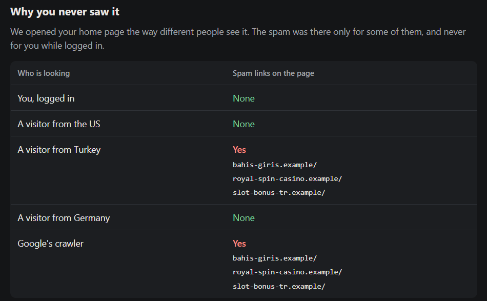

# Hacked Site Rescue

*Demo project — the dental practice is fictional and every infection sample is
inert.* A complete, reproducible WordPress cleanup: a lab site infected with
seven techniques taken from real incidents, a scanner that finds them, a plan
that removes them, and proof that the site is clean and stays clean.

## The problem it shows

Hacked WordPress sites rarely look hacked to their owners. The spam in this lab
is served only to visitors from one country and to Google's crawler, never to
a logged-in administrator. And deleting the obvious file does not help: a
scheduled task rebuilds it from a copy hidden in the database within the hour.
`demo.sh` shows both on a live site before cleaning it properly.

## What is in the lab

| # | Technique | Where it hides |
|---|---|---|
| 1 | Casino links shown only to one country and to Googlebot | a must-use plugin posing as a cache helper |
| 2 | Invisible links inside blog posts | post content |
| 3 | Administrator removed from the Users screen | database + a filter in the theme |
| 4 | "Backdoor" with obfuscated code | the uploads folder |
| 5 | Reinfection: a cron task rewrites #1 from the database | options + theme |
| 6 | One line added to a WordPress core file | `wp-includes/` |
| 7 | The trail: password guessing, upload through a plugin, login | access log |

The samples behave like the real thing when scanned or viewed, but nothing in
them executes code supplied from outside; the backdoor only answers a marker.

## Run it

Requirements: Docker, Git Bash or any POSIX shell, curl.

    cp lab/.env.example lab/.env   # set the two passwords
    ./demo.sh

About three minutes. It builds a fresh site, infects it, scans it, shows a
quick cleanup failing, applies the generated plan, scans again, runs every
scheduled task and scans once more, then writes the owner report to
`report/owner-report.html`. It exits non-zero unless both scans after cleanup
are clean.

## The scanner

`scanner/` is a single Go binary that reads files, database, live pages and
the access log, and changes nothing:

    rescue -root ./site -db 'user:pass@tcp(host:3306)/db' -url https://example.com -log access.log
    rescue plan   -findings findings.json -root ./site -owner admin
    rescue report -site "Name" -before out -after after -later later

Checks: core files against wordpress.org checksums; PHP where it should not
be; code that hides itself (reversed function names, country and bot
conditions, user-list filters, self-restore from the database, includes from
uploads, request-gated behaviour); administrators missing from the dashboard;
non-core scheduled tasks; encoded payloads in settings; invisible links in
posts; pages that differ between the owner and other visitors; and the
break-in sequence in the access log.

The plan only automates what the evidence settles. Anything else — an
unknown must-use plugin, a cron task not traced to malicious code — becomes a
manual step instead of a guess.

## Results on the lab

| | Findings |
|---|---|
| Infected | 25 (15 critical) |
| Visible file deleted, one cron run later | spam back for visitors from Turkey |
| After the planned cleanup | 0 |
| After every scheduled task has run | 0 |
| Freshly built clean site | 0 (no false positives) |

Write-up: [docs/case-study.md](docs/case-study.md).
